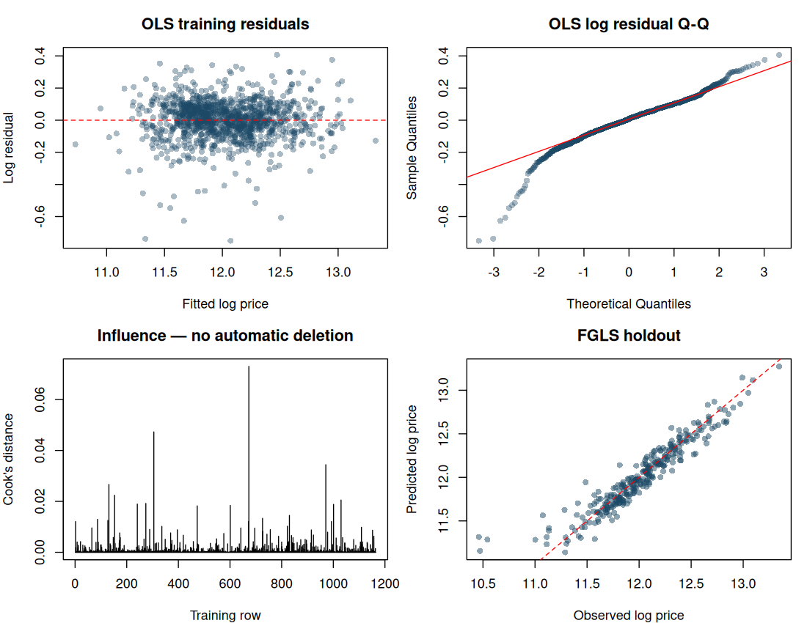
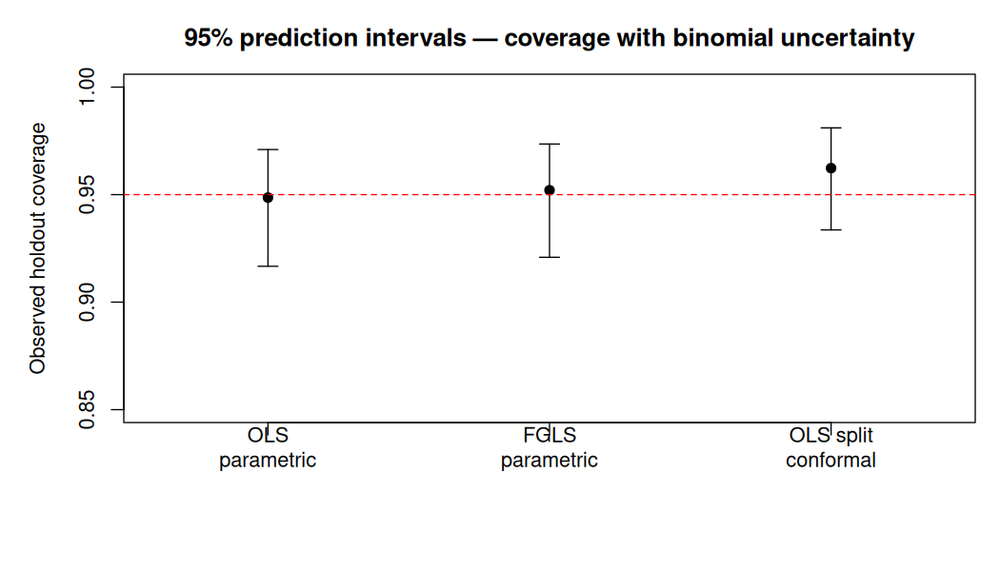

# Ames House Prices: regression, feature engineering and prediction intervals

**Yader Alexander Ramírez Bonilla** · R statistical modelling project using the Ames, Iowa housing data.

The principal analysis has been corrected after an external code review. It retains the original feature engineering, compares OLS and feasible GLS on the **same design matrix**, evaluates ten training folds, and measures individual prediction-interval coverage on a separate holdout. Original linear, XGBoost and blending experiments remain in `source/` as research history.

## Read or reproduce

- [Corrected analysis notebook](analysis/House_Prices.Rmd)
- [Executed results and HTML report](reports/revised/): download the repository and open `reports/revised/index.html` locally.
- [Verified response to the external review](docs/REVIEW_RESPONSE.md): confirmed problems, qualifications and corrections.

From the project root in Positron/RStudio:

```r
source("tests/check_revised.R")
source("run_analysis.R")
```

Or run `Rscript run_analysis.R`. The corrected computation and HTML renderer use **base R**, with no third-party package installation. Optional knitting of the Rmd requires rmarkdown/knitr. `render_report.R` regenerates the same corrected outputs.

## Corrected validation

A raw-data random 80/20 split uses seed 123: **1,168 training / 292 holdout houses**. Ten training folds use seed 42. Medians, categorical mappings, scaling, independent columns and variance weights are learned separately in each analysis partition. No internal-test data are used to fit preprocessing.

The inherited features include house age, total bathrooms, porch presence, condition groups, and pool/miscellaneous/fireplace/masonry indicators. Condition groups are now categorical, as originally intended. ID, redundant component areas and the raw fields replaced by features are excluded. [Feature details](docs/FEATURE_ENGINEERING.md).

The experiment compares fitting all training houses with a **training-only GrLivArea <4000** restriction, assessing both on identical folds containing all validation houses. It does not delete high-error or influential holdout houses. The CV-selected model/policy is FGLS with this training restriction. Its mean CV RMSE-log is **0.14371**, versus **0.14374** for OLS with the same restriction: a tiny descriptive difference, not evidence of a substantial weighting benefit.

## Fresh internal holdout results

| Model, shared selected training policy | RMSE log | RMSE USD | MAE USD | Predictive R² |
|---|---:|---:|---:|---:|
| OLS | 0.13840 | 21,901 | 15,778 | 0.9243 |
| FGLS | 0.13854 | 21,878 | 15,783 | 0.9245 |

[Raw metrics](reports/revised/holdout_metrics.csv) include squared correlation separately from predictive R² = 1 − SSE/SST. FGLS was selected by training CV, even though OLS happens to have a slightly lower holdout log error; the test does not switch the winner. These results are **not a public Kaggle score** and are not directly comparable to the old split/model runs. Exponentiated log predictions are median-type price estimates.



## 95% individual prediction intervals

| Method | Observed holdout coverage | Mean width USD |
|---|---:|---:|
| OLS parametric | 94.86% | 90,123 |
| FGLS parametric | 95.21% | 88,282 |
| OLS split conformal | 96.23% | 104,301 |



[Coverage summaries and binomial confidence limits](reports/revised/interval_summary.csv) and [individual interval rows](reports/revised/holdout_prediction_intervals.csv) are exported. FGLS predicts future variance weights rather than using a future house's own residual. Its parametric intervals remain approximate.

Conformal uses a **separate, prespecified OLS/all-properties** model: 876 proper-training houses and 292 calibration houses from outer training, seed 2026. It uses the exact finite-sample order statistic and never refits on calibration data. Its marginal-coverage theory requires exchangeability; it is not a per-house or Nicaragua coverage guarantee. Different fitting sample sizes and area policies affect width, so this is not an isolated comparison of interval methods. Coverage above 95% alone does not establish perfect calibration or prove population overcoverage.

## What the review changed

- Removed unsupported claims of a large WLS improvement, perfect coverage and applicability to Nicaragua.
- Replaced reciprocal absolute-residual weights with an explicit training-only FGLS variance working model.
- Used shared features, training-only preprocessing and log-scale error diagnostics.
- Replaced the skipped-selection path and checked full rank, novel categories and prediction contracts.
- Evaluated area exclusion as sensitivity, not an automatic universal fix.
- Added exact split-conformal quantiles and uncertainty around observed coverage.
- Exported a [new submission](reports/revised/submission_revised.csv) only after assessment; it has not been sent to Kaggle.

The review was not entirely correct: constant future-error variance does not make all prediction intervals equally wide, and original source scripts do contain submission code. Its proposed default R quantile also needed the finite-sample order-statistic correction. [Full verification](docs/REVIEW_RESPONSE.md).

## Historical results and limitations

[Original report](reports/original_report.html), [legacy notebook](analysis/House_Prices_legacy.Rmd), [original Excel intervals](reports/Intervalo_prediccion.xlsx) and [source experiments](source/README.md) are retained for traceability. They contain known issues; use the corrected notebook as the primary analysis. Original XGBoost/blend code has overlapping fitting/evaluation data and has not been assigned new validated scores.

This is a post hoc internal reassessment of a previously explored dataset and inherited feature choices, not a pristine external test. The data describe Ames, Iowa; transfer across countries, time or housing markets remains unvalidated. No improvement in Kaggle leaderboard rank is claimed.
