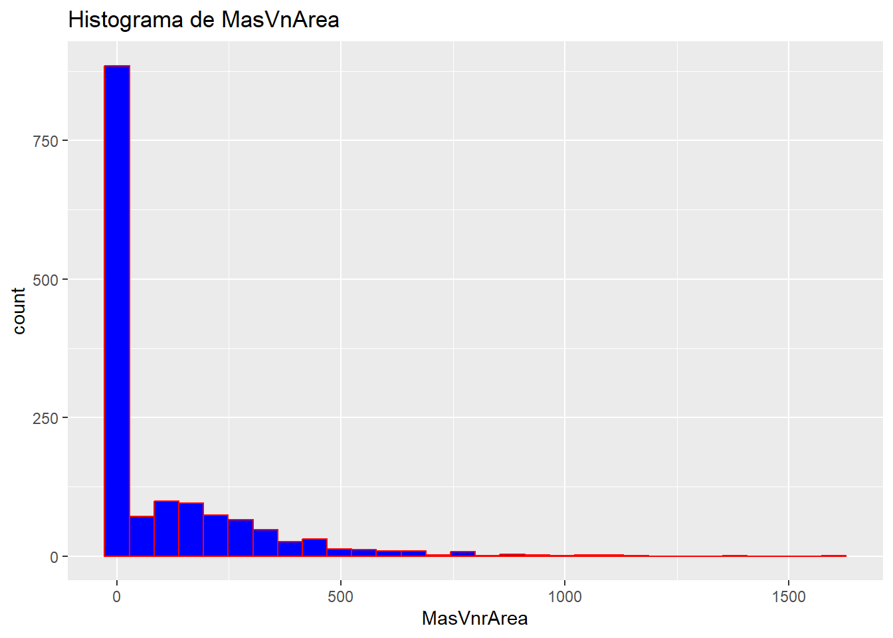
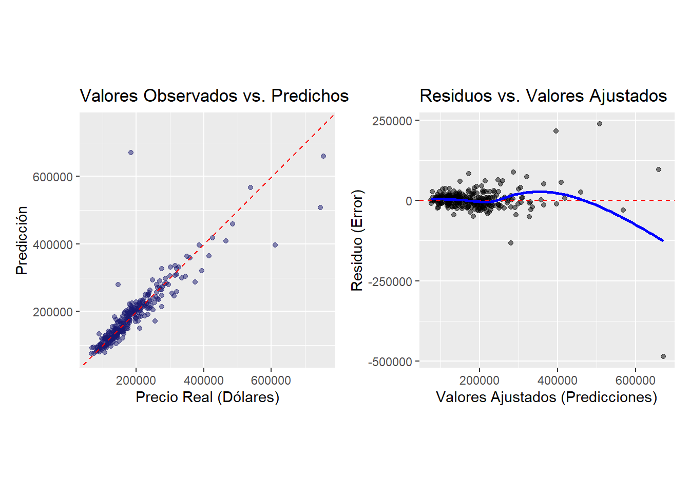
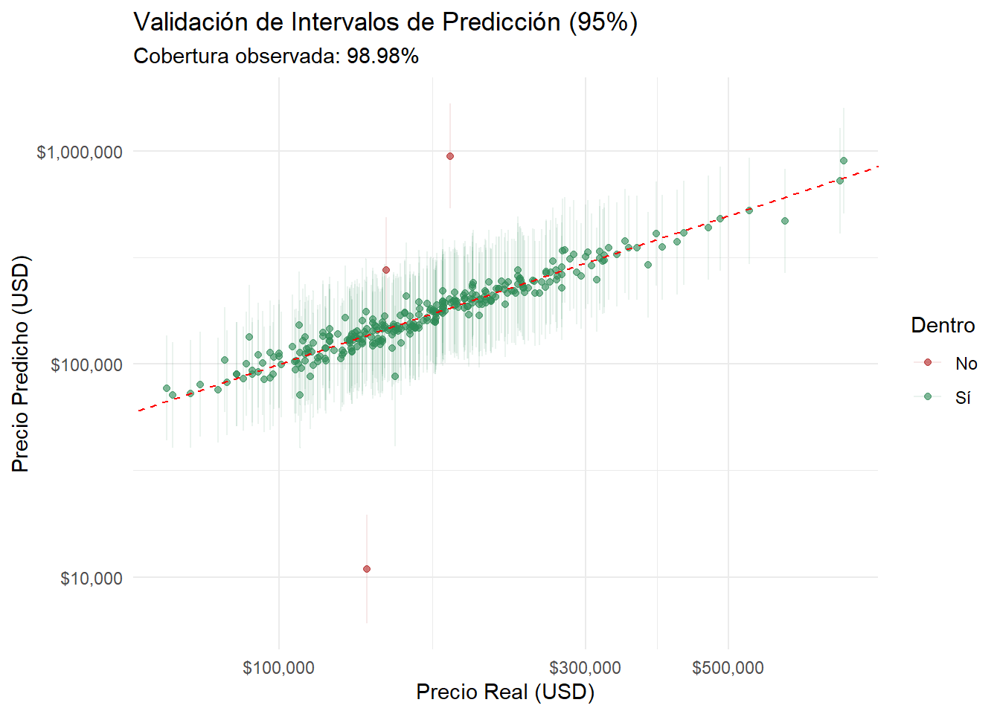
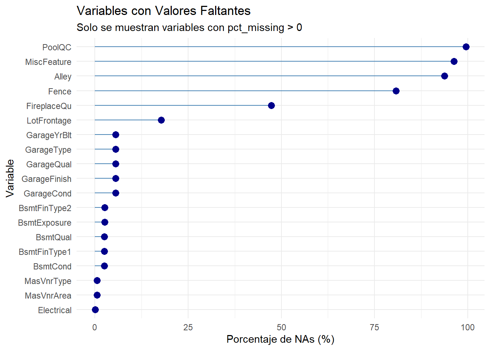

# Ames House Prices: statistical modelling and feature engineering in R

**Author: Yader Alexander Ramírez Bonilla.** An exploratory housing-price study using the Ames, Iowa Kaggle data. This repository presents the supplied analysis: EDA, feature engineering, linear and weighted regression, prediction intervals, XGBoost experiments and linear/XGBoost blending.

## Start here

- [Analysis notebook](analysis/House_Prices.Rmd): original analysis with portable CSV paths.
- [Saved HTML report](reports/original_report.html): download and open locally to read the already-rendered analysis; GitHub displays its source.
- [Original scripts](source/README.md): regression, XGBoost, regularization and blend experiments.
- [Results and interval interpretation](docs/RESULTS_AND_SCOPE.md): recorded outputs and their evaluation scope.

## Feature engineering

| Feature | Construction |
|---|---|
| House age | sale year − construction year |
| Total porch / porch indicator | sum of four porch areas; indicator of positive area |
| Total bathrooms | full bathrooms + 0.5 × half bathrooms, including basement |
| Overall condition groups | ≤4, 5–7, ≥8 |
| Pool, miscellaneous feature, fireplace, masonry indicators | indicator that the relevant area/count/value is positive |
| Log transformations | SalePrice and, in later recipes, LotArea |

Categorical screening selects Neighborhood, ExterQual, BsmtQual, KitchenQual and GarageFinish. Recipes include manual feature removal, dummy encoding, rare-category handling, correlation filtering in some variants and normalization. [Exact formulas and implementation differences](docs/FEATURE_ENGINEERING.md).



## Recorded regression results

These are the **printed outputs in the supplied HTML**, rounded as saved, rather than a new model run:

| Model | Evaluation | RMSE (USD) | Squared correlation (`rsq`) | MAE (USD) |
|---|---|---:|---:|---:|
| Linear | Training | 26,096 | 0.883 | 16,265 |
| Linear | Internal test | 40,897 | 0.800 | 19,212 |
| WLS | Internal test | 50,837 | 0.756 | 18,195 |

The WLS run lowers MAE but increases RMSE in this saved output. Narrative values elsewhere in the original document differ from these printed values; the discrepancy is documented rather than silently combined. XGBoost and blend code is included, but no comparable verified metric export is invented. [Model variants and original parameters](docs/MODELS.md).



## 95% prediction intervals for individual houses

The original work includes **prediction intervals**, not just point estimates. Log-scale lower/upper endpoints are converted to dollars with `exp()`. The WLS notebook calculates them on `Test_split` and plots **98.98% observed coverage** in the saved figure:



A separate [original Excel export](reports/Intervalo_prediccion.xlsx) contains 1,454 training prediction rows and their limits. Recomputed coverage in that export is **96.01%**, mean width **USD 93,483**. This is in-sample coverage from a different branch, not the WLS test result. [Downloadable interval rows](reports/prediction_intervals_original.csv) and [summary](reports/prediction_interval_summary.json).

The WLS HTML contains rank-deficiency and constant-prediction-variance warnings. Its nominal 95% intervals are preserved as the author's exploratory calculation; 100% observed coverage does not itself establish correct calibration. [Formulas, warnings and interpretation](docs/RESULTS_AND_SCOPE.md).

## EDA and diagnostics

The report includes sale-price distribution/QQ plots, Anderson–Darling, missing-value inspection, numeric correlation, ANOVA/categorical screening, derived indicators, Cook's distance, residual scatterplots, residual QQ plots and Lilliefors tests. All ten figures are extracted from the supplied HTML, with English filenames and original Spanish plot labels.



## Run or read the original work

Open `HousePrices.Rproj` in RStudio or the repository folder in Positron. The supplied CSV inputs and dictionary are under `data/`. From the repository root:

```r
source("install_dependencies.R")
source("render_report.R")
```

Rendering uses the original model/statistical steps and writes a new HTML under `outputs/report/`. It was not executed during this repository reformulation; current package versions and original session dependencies may affect rerendering. Reading the saved HTML requires no model training. The standalone scripts are documented exploratory branches, not a new end-to-end pipeline.

## Repository map

- `analysis/`: portable original R Markdown.
- `source/`: supplied R/Rmd experiments and rendering log.
- `data/`: supplied CSVs and variable descriptions.
- `reports/`: supplied HTML/Excel, extracted figures, printed metrics and interval-export summaries.
- `docs/`: feature formulas, model variants, result provenance and statistical scope.

**Scope:** Ames housing, not validated Nicaraguan valuation. Original imputation/selection occur before the internal split, and some script evaluations overlap their fit data. These limitations are documented; the repository does not claim that the original experiments constitute leakage-free external validation. No new models, conformal intervals or bootstrap experiments have been added.

Repository reformulation preserves the original research rather than replacing it with a proposed workflow. Source artifacts were checked, all ten embedded figures extracted, and the Excel's membership flags/coverage/widths independently recalculated. No original fitted model was rerun.
