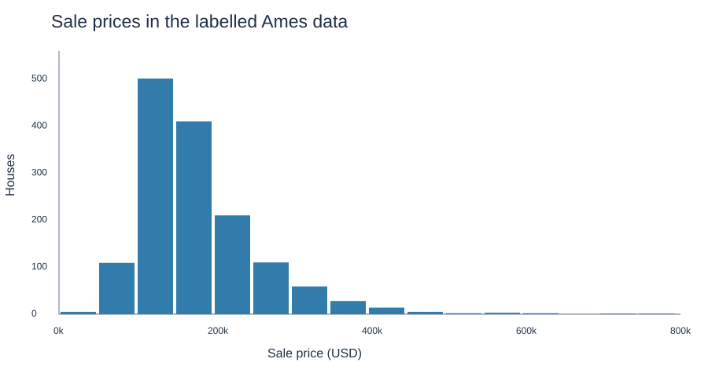
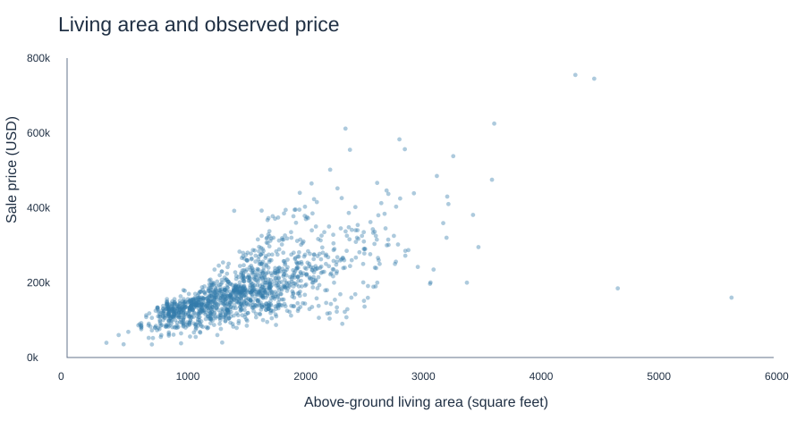

# Ames House Prices — R, tidymodels and XGBoost

A housing-price regression project comparing a linear baseline, tuned XGBoost and a fixed blend on the Ames, Iowa competition dataset. The project combines exploratory analysis, feature engineering, cross-validation, residual diagnostics and uncertainty in performance differences.

**Status:** historical experiments are archived; a revised reproducible R pipeline is provided. Its model metrics are **pending execution**. No training-set metric or unverified competition score is presented as held-out performance. The former README reported R² = 0.918 and 100% prediction-interval coverage; these are retained as historical claims in the archive, not verified revised results.

## Data at a glance

| File | Houses | Columns | Target |
|---|---:|---:|---|
| Kaggle train | 1,460 | 81 | SalePrice |
| Kaggle test | 1,459 | 80 | Unavailable |

The supplied labelled data span USD 34,900–755,000, with a median of USD 163,000. These are descriptive figures, not model performance. This is a US housing dataset; no claim is made about valuation in Nicaragua.





These plots describe all labelled observations already available during historical exploration. They are not plots of held-out model predictions.

## Modelling approach

- Predict natural-log SalePrice; evaluate log RMSE as the primary metric.
- Hold out 20% of labelled rows; use five-fold CV within training.
- Learn imputation, encoding and normalization separately within resampling fits.
- Compare linear regression with 20 XGBoost tuning configurations on the same folds.
- Evaluate a fixed 60/40 blend of dollar-scale linear/XGBoost predictions.
- Export dollar RMSE/MAE, predictive R², paired bootstrap CIs, residual plots and three Kaggle submission files.

No residual-based or living-area deletion is performed in the revised pipeline. This avoids silently narrowing the evaluation population. Feature engineering follows the original project, while session dependencies and mixed evaluation scales are corrected. [Methodology and limitations](docs/METHODOLOGY.md).

## Run locally

1. Download the competition files from [Kaggle](https://www.kaggle.com/competitions/house-prices-advanced-regression-techniques/data) and place `train.csv` / `test.csv` in `data/raw/`.
2. Open `HousePrices.Rproj` in RStudio, or open the repository folder in Positron.
3. Run from the repository root in a fresh R session:

```r
source("install_dependencies.R")
source("01_prepare.R")
source("02_fit.R")
source("03_evaluate.R")
source("04_submission.R")
```

`source("run_all.R")` executes the four stages. `source("05_eda.R")` exports descriptive figures separately from model evaluation. Set seeds and budget in `00_config.R`. A default run evaluates 20 × 5 XGBoost candidate/fold combinations, plus the linear CV and final fits. Engine submodel reuse may reduce actual fit count. Runtime depends on hardware. The tuning stage has no mid-run checkpoint.

Generated outputs are written to `outputs/run_v1/` and ignored by Git. Use a new run directory after changes to inputs, scripts, packages or configuration. The preparation step guards against mixing incompatible configurations. Package versions are recorded when preparation runs; a verified lockfile is not yet available.

## Outputs after execution

| Output | Purpose |
|---|---|
| `tables/cv_log_metrics.csv` | Cross-validation metrics on log-price scale |
| `tables/best_hyperparameters.csv` | Best XGBoost configuration by CV log RMSE |
| `tables/holdout_metrics.csv` | Internal held-out point estimates |
| `tables/holdout_metric_ci.csv` | Conditional 95% bootstrap CIs by model |
| `tables/paired_improvement_ci.csv` | Paired differences against Linear |
| `figures/observed_vs_predicted.png`, `residuals.png` | Held-out diagnostics |
| `submission_linear.csv`, `submission_xgboost.csv`, `submission_blend.csv` | Kaggle-format predictions |

Metric CIs are not house-level prediction intervals. The previously explored data do not become a new external validation set simply by resplitting them. No automatic Kaggle submission is performed.

## Project history

`archive/` contains the original exploratory R/Rmd files, clearly separated from the runnable pipeline. Their local paths and historical claims are not endorsed as revised results. Saved workspaces, console history, logs and the old HTML report are excluded.

Author: Yader Alexander Ramírez Bonilla. Data source: [House Prices — Advanced Regression Techniques](https://www.kaggle.com/competitions/house-prices-advanced-regression-techniques). Competition data should be obtained from the source under its rules. No license for the source data is asserted here.

**Preparation checks:** input dimensions, IDs, positive targets, declared output paths and documentation links checked. EDA summaries/figures generated from the supplied CSV. Full R execution and revised model results remain pending.
